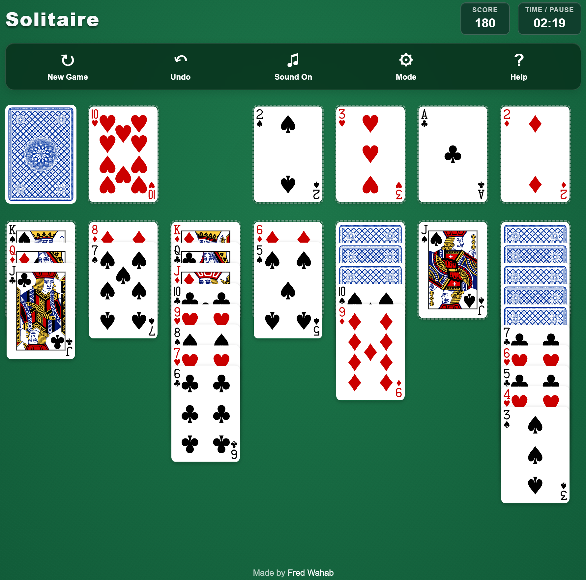

# Solitaire

A responsive, browser-based implementation of classic **Klondike Solitaire**, built with vanilla JavaScript, CSS, SVG, and Vite.

Play with **Draw 1** or **Draw 3** rules, move individual cards or valid sequences, and build all four foundations from Ace to King.

### [▶ Play Solitaire](https://fredwahab.github.io/Solitaire/)



---

## How to Play

The objective is to move all 52 cards into four foundation piles, with each foundation containing one suit in ascending order from Ace through King.

### Tableau

The tableau consists of seven columns.

- Cards build downward in rank.
- Colors must alternate between red and black.
- Valid face-up sequences can be moved together.
- Only Kings, or sequences beginning with a King, may occupy an empty column.
- Moving cards can reveal previously hidden cards.

For example, a red Queen can be placed on a black King, and a black Jack can be placed on that Queen.

### Foundations

Each foundation begins with an Ace and builds upward through King in the same suit.

All four foundations must contain 13 cards to win.

### Stock and Waste

The stock contains the undealt cards.

Click the stock to turn cards into the waste pile. Only the top waste card may be moved to the tableau or a foundation.

When the stock becomes empty, click its position to recycle the remaining waste cards.

The game permits unlimited passes through the stock.

---

## Game Modes

Select a mode using the **Mode** button.

| Mode | Behavior |
|---|---|
| Draw 1 | Reveal one card per stock click |
| Draw 3 | Reveal up to three cards per stock click |

**Draw 1** generally offers easier access to cards.

**Draw 3** requires more planning because only the top card of each revealed group is immediately playable.

The selected mode takes effect when the next new game begins. Changing the preference does not alter a game already in progress.

The game remembers the selected mode using browser local storage.

---

## Controls

| Action | Desktop | Mobile |
|---|---|---|
| Start a game | New Game or click the initial deck | New Game or tap the initial deck |
| Draw from stock | Click stock | Tap stock |
| Move a card | Drag and drop | Touch and drag |
| Move a sequence | Drag a valid face-up sequence | Touch and drag a valid sequence |
| Automatic move | Double-click a movable card | Double-tap a movable card |
| Undo | Undo button | Undo button |
| Pause | Click the timer | Tap the timer |
| Resume | Resume button | Resume button |
| Sound | Sound button | Sound button |
| Change mode | Mode button | Mode button |
| View tutorial | Help button | Help button |

Invalid moves are rejected without changing the game state.

### Interactive Tutorial

The **Help** button opens a guided, nine-step tutorial explaining:

1. The objective of Solitaire
2. The tableau layout
3. Alternating-color rules
4. Moving card sequences
5. The stock and waste piles
6. Draw 1 and Draw 3 rules
7. Foundations and Kings
8. The available controls
9. Starting and winning a game

Players can navigate backward and forward through the tutorial without losing their current game.

---

## Features

- Classic Klondike Solitaire gameplay
- Standard randomized 52-card deck
- Draw 1 and Draw 3 game modes
- Unlimited stock recycling
- Seven tableau columns
- Four foundation piles
- Individual card and sequence movement
- Drag-and-drop controls
- Double-click and double-tap automatic moves
- Legal move validation
- Automatic revealing of hidden tableau cards
- Undo history
- Score tracking
- Timer with pause and resume
- Automatic completion when a winning sequence can be verified
- Animated opening deal
- Smooth automatic card movement
- Victory confetti and sound effects
- Interactive step-by-step tutorial
- Responsive desktop, mobile portrait, and mobile landscape layouts
- Unified toolbar across devices
- Textured felt-table appearance
- Persistent sound preferences
- Persistent game mode preferences
- Custom favicon and Apple touch icon
- Automated deployment to GitHub Pages

---

## Scoring

| Action | Points |
|---|---:|
| Reveal a hidden tableau card | +5 |
| Move waste to tableau | +5 |
| Move a card to a foundation | +10 |
| Move a card from foundation to tableau | -15 |

The timer begins after the player's first successful gameplay action, rather than immediately when cards are dealt.

The timer stops when the game is won.

---

## Technology

Solitaire was developed without a game engine or frontend UI framework.

| Technology | Purpose |
|---|---|
| JavaScript (ES Modules) | Game rules, state management, and input handling |
| HTML5 | Interface structure |
| CSS3 | Responsive layouts and styling |
| SVG | Playing-card artwork |
| Canvas API | Victory confetti animation |
| Web Animations API | Opening deal and card movement animations |
| Howler.js | Cross-browser audio playback |
| Local Storage | Persistent sound and game mode preferences |
| Vite | Development server and production builds |
| GitHub Actions | Automated deployment |
| GitHub Pages | Static website hosting |

---

## Technical Overview

The application separates game rules, rendering, interactions, and audio into individual modules.

### Project Structure

```text
Solitaire/
├── index.html
├── package.json
├── vite.config.js
├── public/
│   ├── cards/
│   ├── audio/
│   │   └── solitaire/
│   ├── favicon.svg
│   └── apple-touch-icon.png
├── src/
│   ├── main.js
│   ├── style.css
│   ├── game/
│   │   ├── Card.js
│   │   ├── Deck.js
│   │   ├── SolitaireGame.js
│   │   └── SolitaireAudio.js
│   └── ui/
│       └── SolitaireRenderer.js
└── README.md
```

### Game Engine

`SolitaireGame.js` manages:

- Deck creation, shuffling, and dealing
- Stock and waste piles
- Tableau and foundation piles
- Draw 1 and Draw 3 mechanics
- Move validation
- Scoring
- Win detection
- Automatic completion
- Undo snapshots

Game rules remain independent of the visual interface.

### Rendering

`SolitaireRenderer.js` builds the game's interface and renders cards based on the current game state.

Playing cards use SVG artwork, retaining sharp detail across screen sizes.

The renderer dynamically calculates tableau height so longer columns expand the board rather than overlap the footer.

### Input and Animation

`main.js` handles mouse, touch, and pointer interactions.

Pointer Events allow the same drag-and-drop system to work across desktop and touchscreen devices.

The Web Animations API is used for the animated opening deal and automatic card movement.

The victory celebration uses a lightweight Canvas animation.

The game respects reduced-motion preferences.

### Stock and Waste Management

Draw 1 reveals one card per stock click.

Draw 3 reveals up to three cards per stock click.

Only the top waste card can be played, regardless of the selected mode.

When the stock is exhausted, remaining waste cards can be recycled.

Unlimited stock passes are supported.

### Undo System

The game captures a state snapshot before each successful move using JavaScript's `structuredClone()` method.

Undo restores the previous:

- Stock and waste
- Tableau columns
- Foundation piles
- Face-up and face-down card states
- Score

This includes stock draws and recycling in both game modes.

### Automatic Completion

When the remaining game can be completed entirely through legal foundation moves, automatic completion begins.

The game first verifies that:

1. The stock and waste are empty.
2. All remaining tableau cards are face-up.
3. Every remaining card can be moved legally to a foundation.

The game simulates the remaining moves before starting the animation.

If a complete winning sequence exists, the cards are moved automatically to the foundations.

The timer stops when all four foundations are complete.

### Audio

Solitaire uses **Howler.js** for sound playback.

The audio system includes sounds for:

- Drawing cards
- Moving cards
- Moving sequences
- Undo
- Recycling the stock
- Starting a new game
- Completing a game

The game uses locally hosted audio files and saves the mute setting in browser local storage.

### Preferences

Browser local storage remembers:

- Sound enabled or muted
- Draw 1 or Draw 3 selection

Individual game progress is not saved across page reloads.

---

## Running Locally

### Prerequisites

- Node.js
- npm
- Git

### Installation

Clone the repository:

```bash
git clone https://github.com/FredWahab/Solitaire.git
cd Solitaire
```

Install dependencies:

```bash
npm install
```

Start the development server:

```bash
npm run dev
```

Open the local URL displayed in your terminal.

### Production Build

Generate a production build:

```bash
npm run build
```

Build output is placed in the `dist/` directory.

Preview the production build:

```bash
npm run preview
```

---

## Deployment

Solitaire is hosted on GitHub Pages:

**https://fredwahab.github.io/Solitaire/**

Deployment is automated using GitHub Actions.

The deployment process:

1. Checks out the repository.
2. Installs Node.js and project dependencies.
3. Builds the application using Vite.
4. Uploads the generated production files.
5. Publishes the build to GitHub Pages.

The Vite configuration uses `/Solitaire/` as the base path for GitHub Pages hosting.

---

## Assets and Credits

### Playing Cards

Playing-card SVG assets are sourced from:

**[Public Domain and CC0 Playing Cards — Austin Gabriel](https://github.com/AustinGabriel/Public-Domain-and-CC0-Playing-Cards)**

Additional attribution information is maintained in:

`public/cards/citation.txt`

### Audio

Card and casino-style audio recordings are based on **Kenney's Casino Audio** pack, released under CC0.

https://kenney.nl/assets/casino-audio

The project also includes a custom victory sound.

### Libraries

- [Howler.js](https://howlerjs.com/) — Audio playback
- [Vite](https://vite.dev/) — Development and production builds

---

## Future Improvements

Potential enhancements beyond v1.1 include:

- Optional hints
- Restarting the same shuffled deal
- Saved game progress
- Game statistics and win tracking
- Additional scoring options
- Expanded keyboard accessibility
- More customization options

---

## Author

**Fred Wahab**

[GitHub Profile](https://github.com/FredWahab)

Built as part of a browser game development and software engineering portfolio.